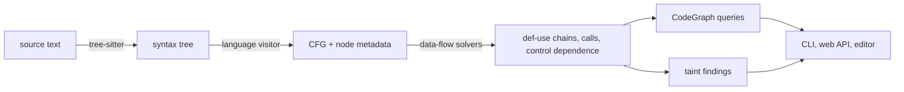

# Architecture

This document explains how Tree Climber is built. It starts with one paragraph and adds detail at each level. Stop reading when you have enough.

1. [The short version](#1-the-short-version)
2. [The layers](#2-the-layers)
3. [One program, through every layer](#3-one-program-through-every-layer)
4. [The interesting parts](#4-the-interesting-parts)
5. [Where to start reading](#5-where-to-start-reading)

The Python examples below run in order, and their output is checked by `test/test_architecture_doc.py`. They stay true as the code changes.

## 1. The short version

Tree Climber turns source code into graphs, then answers questions with them.

It parses C, Java or Python with tree-sitter. It builds a control flow graph (CFG): one node per statement, one edge per possible next step. It computes how values flow between statements. On top of those graphs it answers queries ("what does this line depend on?") and runs taint analysis ("can user input reach `os.system`?"). A command line tool, a web API and an editor in the browser present the results.



Each arrow is a separate layer. Each layer only reads the layer before it.

## 2. The layers

All code is under `src/tree_climber/`.

| Layer | Package | What it does | Start with |
|---|---|---|---|
| Languages | `language_registry.py` | Lists the languages, their file extensions and their visitors. | `get_language`, `create_visitor` |
| Syntax | `ast_utils.py` | Parses text with tree-sitter. Walks trees without recursion. | `parse_source_to_ast` |
| Control flow | `cfg/` | Builds the CFG and each node's metadata: definitions, uses, calls. | `CFGBuilder.build_cfg` |
| Data flow | `dataflow/` | Reaching definitions, def-use chains, flows between functions, control dependence. | `WorklistSolver.solve` |
| Queries | `query/` | `CodeGraph`: lookups, paths, slices, export to networkx. Caches every analysis. | `CodeGraph.from_source` |
| Taint | `taint/` | Rules (sources, sinks, sanitizers) and the engine that follows tainted values. | `analyze` |
| Front ends | `cli/`, `viz/`, `reporting.py` | The `tree-climber` command, the FastAPI server, the React editor. | `cli/__main__.py`, `viz/app.py` |
| Testing at scale | `stress.py` | Runs every layer over large corpora and reports crashes and slow files. | `python -m tree_climber.stress` |

The dependencies point one way: taint uses queries, queries use data flow, data flow uses the CFG. Nothing in a lower layer imports a higher one.

## 3. One program, through every layer

This section follows one small program from text to a finding. It reads input, checks it, and passes it to a shell.

```python
from tree_climber.query import CodeGraph

SOURCE = """\
import os

def run(cmd):
    os.system(cmd)

host = input()
if host:
    run(host)
"""
graph = CodeGraph.from_source("python", SOURCE)
print(len(graph.nodes), "nodes")
```

```
9 nodes
```

### The CFG

Each statement is a node. Each function has an ENTRY and an EXIT node. The module's top-level code is a function too, called `<module>`.

```python
def show(node):
    edges = []
    for successor in sorted(node.successors):
        label = node.edge_labels.get(successor)
        edges.append(f"{successor} ({label})" if label else str(successor))
    return f"[{node.id}] {node.node_type.name:<9} {node.source_text:<15} -> {', '.join(edges) or '-'}"


for node in graph.nodes:
    print(show(node))
```

```
[0] ENTRY     <module>        -> 2
[1] EXIT      <module>        -> -
[2] STATEMENT import os       -> 6
[3] ENTRY     run             -> 5
[4] EXIT      run             -> 9 (function_return)
[5] STATEMENT os.system(cmd)  -> 4
[6] STATEMENT host = input()  -> 7
[7] CONDITION host            -> 1 (false), 9 (true)
[9] STATEMENT run(host)       -> 1, 3 (function_call)
```

Things to notice:
- The `if` became a CONDITION node that holds its test, `host`. It has `true` and `false` edges.
- `run(host)` has a `function_call` edge into `run`. The EXIT of `run` has a `function_return` edge back.
- There is no node 8. It was the join point after the `if`. The builder removes such helper nodes at the end (see [4.2](#42-building-the-cfg)).

### Node metadata

Every node also records what it defines, what it uses and what it calls. The data-flow layer needs nothing else.

```python
node = graph.by_text("host = input()", exact=True)[0]
print("defines:", node.metadata.variable_definitions)
print("uses:   ", node.metadata.variable_uses)
site = node.metadata.call_sites[0]
print("calls:  ", site.callee_text, "assigned to", site.assigned_to)
```

```
defines: ['host']
uses:    ['input']
calls:   input assigned to ['host']
```

Names of called functions count as uses too, so `input` is listed. Each call is also described in full by a `CallSite`.

### Reaching definitions and def-use chains

A definition *reaches* a node when some path leads from it to the node without redefining the variable. From that, each definition gets the list of nodes that use it: a def-use chain.

```python
for name, chains in sorted(graph.def_use_chains.chains.items()):
    for chain in chains:
        print(f"{name}: defined at {chain.definition}, used at {chain.uses}")
```

```
cmd: defined at 3, used at [5]
host: defined at 6, used at [7, 9]
```

These chains stay inside one function. `host` does not flow into `cmd` yet.

### Flows between functions

The interprocedural analysis adds the flows that cross function boundaries: arguments into parameters, return values into calls, and free variables into the functions that read them.

```python
for edge in graph.interprocedural_edges():
    print(f"[{edge.source}] {edge.source_variable} --{edge.kind}--> [{edge.target}] {edge.target_variable}")
```

```
[9] host --argument--> [3] cmd
[2] os --free_variable--> [5] os
```

`host` at the call `run(host)` flows into the parameter `cmd`. The module-level `os` flows into the body of `run`.

### Control dependence

A node is *control dependent* on a branch when the branch decides whether the node runs.

```python
call = graph.by_text("run(host)", exact=True)[0]
for branch, label in graph.control_dependences(call):
    print(f"[{call.id}] runs when [{branch.id}] {branch.source_text} is {label}")
```

```
[9] runs when [7] host is true
```

### A slice

A forward slice is every node whose value depends on a starting node. With the interprocedural edges, it crosses into `run`.

```python
reached = graph.forward_slice(node, extra_edges=graph.interprocedural_edges())
print([n.source_text for n in reached])
```

```
['run', 'os.system(cmd)', 'host = input()', 'host', 'run(host)']
```

### A taint finding

Taint asks a narrower question. Can a value from a *source* (`input()`) reach an argument of a *sink* (`os.system`)? The built-in rules list common sources and sinks.

```python
from tree_climber.taint import analyze, builtin_rules

for finding in analyze(graph, builtin_rules("python"), "python"):
    print(finding)
```

```
python-command-injection: argument 0 of os.system
[6] host = input()
  --def_use host--> [9] run(host)
  --argument cmd--> [3] ENTRY run
  --def_use cmd--> [5] os.system(cmd)
```

The finding carries its path, one step per edge. Every layer above contributed one piece: the CFG, the metadata, the def-use chains, and the argument flow.

## 4. The interesting parts

Each part starts with a summary, then the code, then the theory where there is one.

### 4.1 The language registry

**Summary:** one table lists the languages. Everything else asks it.

`language_registry.py` holds a `LanguageSpec` per language: its name, its file extensions, and the class that builds its CFG.

```python
from tree_climber.language_registry import LANGUAGES, language_for_extension

for spec in LANGUAGES.values():
    print(spec.name, spec.extensions, spec.visitor)
print(language_for_extension(".pyi"))
```

```
c ('.c', '.h') tree_climber.cfg.languages.c:CCFGVisitor
java ('.java',) tree_climber.cfg.languages.java:JavaCFGVisitor
python ('.py', '.pyi') tree_climber.cfg.languages.python:PythonCFGVisitor
python
```

The visitor is a `"module:Class"` string. `create_visitor` imports it only when it is needed, so listing languages stays cheap. The CLI, the API, the stress runner and the tests all read this table. Adding a language means one new entry and one new visitor.

### 4.2 Building the CFG

**Summary:** a visitor walks the syntax tree. Each kind of syntax node has a method that returns a small piece of graph. The pieces are wired together as the walk returns.

#### The visitor pattern

`CFGVisitor.visit` dispatches on the syntax node's type. A node of type `if_statement` goes to `visit_if_statement`. Types without a method fall back to `generic_visit`, which visits the children in order.

```python
# cfg/visitor.py (docstring trimmed)
def visit(self, node: Node) -> CFGTraversalResult:
    method_name = f"visit_{node.type}"
    visitor = getattr(self, method_name, self.generic_visit)
    return visitor(node)
```

Each language subclasses `CFGVisitor`: `cfg/languages/c.py`, `java.py` and `python.py`.

#### Pieces with one entry and many exits

Every visit method returns a `CFGTraversalResult`: the ID of the piece's entry node, and the IDs of its exit nodes. A statement has one exit. An `if` without an `else` has two ways out. A `return` has none, because control leaves the function.

The caller connects the previous piece's exits to the next piece's entry. That is all sequencing is:

```python
# cfg/languages/python.py, _visit_statements (trimmed)
for statement in statements:
    result = self.visit(statement)
    if first_entry is None:
        first_entry = result.entry_node_id
    else:
        for exit_id in current_exits:
            self.cfg.add_edge(exit_id, result.entry_node_id)
    current_exits = result.exit_node_ids
```

#### Join nodes, and why node 8 disappeared

An `if` has two branches that meet again. The visitor makes that easy with a helper node, the *join*: both branches end there, and the `if` returns it as its only exit.

```python
# cfg/languages/python.py, visit_if_statement (trimmed)
cond_id = self._create_condition(condition, NodeType.CONDITION)
join_id = self.create_node(NodeType.EXIT, source_text="EXIT: if stmt")
self._visit_body(consequence, cond_id, join_id, "true")
...
self.cfg.add_edge(pending_cond, join_id, "false")
return CFGTraversalResult(entry_node_id=cond_id, exit_node_ids=[join_id])
```

Join nodes are not real statements. After the walk, `postprocess_cfg` splices them out, along with `case` labels. Each predecessor is connected straight to each successor, and the labels are kept. Of the ENTRY and EXIT nodes, only each function's own pair stays. That is why node 8 is missing above: `host` now goes straight to the module's EXIT on `false`.

#### Loops, `break` and `continue`

A `while` loop is a LOOP_HEADER node. The body's exits go back to the header. The header's `false` edge leaves the loop.

`break` and `continue` need to know where to jump. The visitor keeps a stack of loop targets in `ControlFlowContext`. Entering a loop pushes its exit and its header. Leaving pops them. A `break` jumps to the top exit, so nested loops work without any search.

```python
# cfg/languages/python.py, visit_while_statement (trimmed)
header_id = self._create_condition(condition, NodeType.LOOP_HEADER)
exit_id = self.create_node(NodeType.EXIT, source_text="EXIT: while loop")
self.context.push_loop_context(exit_id, header_id)
self._visit_body(body, header_id, header_id, "true")
self.context.pop_loop_context()
```

#### Calls are linked after the walk

A call can name a function defined later in the file. So calls are not linked during the walk. `_link_function_calls` runs at the end, when every function is known. It adds a `function_call` edge from the calling node to each function with that name, and a `function_return` edge back from the function's EXIT.

Calls are resolved by name only. A call to `run` reaches every function named `run`. This is simple and predictable, but it over-approximates when names repeat.

#### Node metadata

`create_node` fills in each node's metadata from its syntax subtree, through four methods that each language implements:

| Method | Gives | Example for `y = x + f(z)` |
|---|---|---|
| `get_definitions` | names written | `y` |
| `get_uses` | names read | `x`, `f`, `z` |
| `get_direct_uses` | names read outside any call | `x` |
| `get_call_sites` | one `CallSite` per call: callee, arguments, receiver, where its result goes | `f(z)`, assigned to nothing |

`create_node` asks `node_facts` for all four at once. By default it calls the four methods, but each built-in language overrides it to collect them in fewer walks of the subtree. C and Java walk it once (`Occurrences` in `call_sites.py`), and Python finds the call nodes once and gets the definitions, uses and direct uses from one bindings walk.

One more rule lives in the base class. A call to a mutating method, such as `items.append(v)`, counts as a definition of `items`. The node also reads `items`, so the old contents flow through it to later reads. This is a *weak update*: the list changes, but it is not replaced.

#### No recursion over syntax trees

Generated code can nest thousands of levels deep (`a = b = c = ...`), which would overflow Python's recursion limit. So the walks over syntax subtrees use an explicit stack. `ast_utils._postorder` yields each node twice, before and after its children:

```python
# ast_utils.py (docstring and annotations trimmed)
def _postorder(node):
    stack = [(node, False)]
    while stack:
        current, children_done = stack.pop()
        yield current, children_done
        if not children_done:
            stack.append((current, True))
            stack.extend((child, False) for child in reversed(current.children))
```

**Theory: control flow graphs.** A CFG is a directed graph. Nodes are basic steps of the program. An edge from A to B means B can run right after A. A path through the graph is a possible execution, if conditions are ignored. Every analysis below asks questions about these paths. Tree Climber puts one statement in each node, rather than grouping statements into basic blocks. The graphs are larger, but results map directly onto lines of code.

### 4.3 Reaching definitions: the data-flow solver

**Summary:** reaching definitions are found by repeating a simple local rule until nothing changes. A worklist keeps the repeats few.

#### The problem

For every node, which definitions reach it? A definition of `x` reaches a node if some path gets there without another definition of `x` on the way.

Each node has a local rule, its *transfer function*:

- **gen:** the definitions the node makes.
- **kill:** the definitions of the same variables made elsewhere.
- **out = (in − kill) ∪ gen**.

Where paths merge, the incoming sets are joined by union (the *meet*): a definition reaches a node if it arrives along any path.

```python
# dataflow/analyses/reaching_definitions.py, ReachingDefinitionsGenKill (trimmed)
defined_variables, gen_facts = self.gen(node)
kill_facts = {
    fact for fact in in_facts
    if isinstance(fact, ReachingDefinition) and fact.variable_name in defined_variables
}
return (in_facts - kill_facts) | gen_facts
```

#### Loops need more than one pass

In a loop, the end of the body flows back to the header. So a definition inside the loop can reach the loop's own first statement. One pass cannot see that: the header is visited before the body. The solver must repeat until the sets stop changing.

```python
loop = CodeGraph.from_source("python", "x = 0\nwhile x < 3:\n    x = x + 1\nprint(x)\n")
increment = loop.by_text("x = x + 1", exact=True)[0]
reaching = loop.reaching_definitions.in_facts[increment.id]
print(sorted((fact.variable_name, loop.node(fact.node_id).source_text) for fact in reaching))
```

```
[('x', 'x = 0'), ('x', 'x = x + 1')]
```

Both `x = 0` (first time round) and `x = x + 1` (later times round) reach the increment.

#### The worklist in reverse postorder

`WorklistSolver` (in `dataflow/solver.py`) keeps a queue of nodes to evaluate:

1. Put every node in the queue, in *reverse postorder*.
2. Take a node. Compute its IN set from its predecessors' OUT sets, then its OUT set with the transfer function.
3. If OUT changed, queue its successors again.
4. Stop when the queue is empty.

```python
# dataflow/solver.py, WorklistSolver.solve (trimmed)
while worklist:
    node_id = worklist.popleft()
    queued.remove(node_id)
    in_facts[node_id] = problem.meet([frozen[pred] for pred in predecessors[node_id]])
    out = problem.transfer(cfg.nodes[node_id], in_facts[node_id])
    if out == out_facts[node_id]:
        continue
    out_facts[node_id] = out
    frozen[node_id] = frozenset(out)
    for successor in successors[node_id]:
        if successor not in queued:
            queued.add(successor)
            worklist.append(successor)
```

`function_call` and `function_return` edges are left out. A callee's local variables must not leak into its caller. The flows that should cross a call are added separately (see [4.4](#44-flows-between-functions)).

**Theory: monotone data-flow frameworks.** The sets only ever grow, and there are finitely many definitions. So the repeats must stop. The point where they stop is called the *fixpoint*. It is the same whatever order the nodes are visited in. That is why the old `RoundRobinSolver`, which re-evaluates every node on every pass, still serves as an oracle: tests check that both solvers give identical sets.

**Theory: reverse postorder.** A depth-first search finishes a node after all the nodes it leads to. Listing nodes by finishing time, and then reversing the list, gives *reverse postorder*. In it, every node comes before its successors, except along loop back edges. So most nodes see their predecessors' final sets the first time they run. Loops need a few extra visits, and only the nodes inside them pay. On CPython's `unicodeobject.c`, the worklist and a cache of each node's gen set together made solving more than ten times faster.

#### Def-use and use-def chains

`DefUseSolver` turns the IN sets into chains. For each node and each variable it uses, the reaching definitions of that variable are its sources. `UseDefSolver` gives the same edges, grouped the other way.

### 4.4 Flows between functions

**Summary:** each function's data flow is solved separately. `dataflow/interprocedural.py` adds edges for what crosses function boundaries.

- `function_nodes` assigns each node to its function. It walks from each ENTRY without following call or return edges.
- **Argument flows:** the call `run(host)` binds argument 0 to parameter `cmd` of every function named `run`. Receivers bind to `self` in Python methods.
- **Return flows:** a `return` node flows into every call that may reach it.
- **Free-variable flows:** a closure's or a global's definition flows into the functions that read the name without defining it. This uses the `locals`, `globals` and `nonlocals` recorded on each function's ENTRY. These flows ignore order: every definition reaches every such use.

These are *context-insensitive*. A function called from two places has one body, so a value can enter from one call and leave through the other. With `def wrap(a): return a`, tainting one `wrap(...)` call taints every `wrap(...)` result. It is a deliberate trade: simple and fast, at some cost in precision. The [taint guide's limitations](taint-guide.md#7-when-a-finding-is-missing-or-should-not-be-there) list this and the other trades.

### 4.5 Control dependence

**Summary:** a branch controls a node if one of its edges makes the node run, and another edge can avoid it. This is computed from post-dominators.

**Theory: post-dominators.** Node Y *post-dominates* node X if every path from X to the function's exit passes through Y. The *immediate* post-dominator of X is the closest one. In an `if` without `else`, the statement after the `if` post-dominates the condition: both branches reach it. The `then` body does not: the `false` edge skips it.

`dataflow/control_dependence.py` computes immediate post-dominators with the algorithm of Cooper, Harvey and Kennedy. It is the usual dominator algorithm, run on the reversed graph: start from the exit, and repeatedly intersect the candidates of each node's successors until nothing changes.

Then, for each branch B and each of its edges B → S, it walks up the post-dominator tree from S. It stops at B's own immediate post-dominator. Every node passed on the way depends on B through that edge's label:

```python
# dataflow/control_dependence.py (simplified)
for successor, label in edges:
    runner = successor
    while runner is not None and runner != ipdom[branch]:
        controllers = result.controllers.setdefault(runner, [])
        if (branch, label) not in controllers:
            controllers.append((branch, label))
        runner = ipdom[runner]
```

This works for every construct through its edges alone: `match`, `try`/`finally`, loop `else`, `switch`. No construct needs special code.

### 4.6 The query layer

**Summary:** `CodeGraph` wraps a CFG. It computes each analysis on first use, keeps it, and answers questions with plain graph searches.

#### One graph, computed once

`CodeGraph` exposes its analyses as cached properties: `reaching_definitions`, `def_use_chains`, `interprocedural_flows` and `control_dependence`. Taint, the API and the CLI all reuse them. The API also keeps the last four graphs, keyed by language and source text. So the editor's `/parse` and `/taint` for one edit share a single solve.

#### Slices as reachability

Slices run on a *fact graph* (`query/facts.py`), not on the CFG. A fact is a variable at a node, either defined or used there. There are two kinds of moves between facts:

- a definition fact moves to the use facts it reaches (a def-use chain or an extra edge);
- a use fact moves to every definition fact at the same node, because a statement's outputs depend on its inputs.

A forward slice is everything reachable from the starting node's facts. A backward slice follows the moves the other way. Both are a plain graph search:

```python
# query/facts.py (annotations trimmed)
def reach(self, seeds, moves):
    seen = set(seeds)
    stack = list(seen)
    while stack:
        for move in moves.get(stack.pop(), ()):
            if move.target not in seen:
                seen.add(move.target)
                stack.append(move.target)
    return seen
```

**Theory: graph search.** Depth-first search (a stack) and breadth-first search (a queue) both find everything reachable, in time proportional to the edges. They differ in order. Breadth-first search explores by distance, so the first time it reaches a node, it has used the fewest edges. `shortest_path` relies on that. `paths` lists simple paths with a bounded depth-first search. It first does a backward search from the target, so it never enters a branch that cannot reach it.

### 4.7 Taint analysis

**Summary:** taint follows values from sources to sinks along every flow above. It stops at sanitizers, and reports each path it finds.

#### Rules

A rule (`taint/rules.py`) has sources, sinks and sanitizers. Call patterns are globs matched against the whole callee text: `os.system`, `*.execute`, `subprocess.*`. Sources can also be attributes (`request.args`) or parameters (`argv` of `main`). Sinks can watch some arguments only. `builtin_rules("python")` has three example rules: command injection, code injection and SQL injection. C and Java have their own.

#### The engine, in three phases

`analyze` in `taint/engine.py`:

1. **Prepare once.** `_Program` reads the def-use chains, interprocedural flows and control dependence from the `CodeGraph`. It reshapes them into dictionaries for fast lookup.
2. **Find the origins.** Each source occurrence is an *origin*. Each distinct source is searched once, even if several rules share it. Call sources are matched against the distinct callee texts of the file, not every call site. Attribute sources first check for a literal substring, then run a regex.
3. **Run only what can matter.** For each rule, a backward search from its sink calls finds every node that could ever reach one (`reaching_sinks`). An origin outside that set cannot produce a finding, so it is never run. Most origins in ordinary code are skipped this way.

#### One run: a worklist over tainted values

Each remaining origin gets a `_Run`. Taint is tracked per *value*, not per node: a definition `("def", node, variable)`, a use, a call's result, an argument. Values are tuples, so they are cheap to hash.

`mark(value, step)` records a value as tainted, with the step that reached it. A value is marked only once, so each value keeps the first step that reached it:

```python
# taint/engine.py, _Run.mark (annotations trimmed)
def mark(self, value, step):
    if value in self.pred:
        return False
    self.pred[value] = step
    return True
```

A node is queued when one of its inputs becomes tainted. Evaluating it works out, call by call from the innermost, what becomes tainted:

- A call to a **sanitizer** returns a clean value.
- A call to a **source** returns a tainted value.
- A call to a function **defined in the file** returns what its `return` statements send back.
- **Any other call** passes on the taint of its arguments and receiver.

Tainted definitions then flow along the def-use chains and the argument, return and free-variable flows. A tainted argument of a **sink** is a finding.

**Path rebuilding.** Each marked value points to the value that tainted it. To print a finding's path, the engine follows these links back to the origin and reverses them. The queue is first-in, first-out, so paths tend to be short.

**Theory: taint as reachability.** Taint analysis is graph reachability on a graph of values. The edges are data flows, and sanitizers cut them. The worklist works like a breadth-first search that builds this graph as it goes. Only the parts reachable from the origin are ever built.

#### Options that trade speed for precision

- `implicit_flows=True`: a branch on a tainted value taints what it decides. This uses control dependence.
- `field_sensitive=True`: writing `user.name = input()` taints only `user.name`, not all of `user`. `taint/fields.py` reads the first-level fields and constant keys that a statement reads and writes.

### 4.8 The front ends

**Summary:** three thin layers over the same calls.

- **CLI** (`cli/`): `tree-climber FILE --draw-cfg` draws graphs with Graphviz. `tree-climber taint` and `tree-climber query` print findings and slices, as text or JSON. Drawings are laid out once. PNGs are sized to stay under 25 megapixels, and `--format svg` is faster still.
- **Web API** (`viz/app.py`): FastAPI endpoints `/parse`, `/taint` and `/query`. They are plain functions, so they run in a thread pool and do not block the server. `/parse` can leave out the syntax tree, which is most of the response on large files.
- **Editor** (`viz/frontend/`): React with Monaco and Cytoscape. It analyses 300 ms after the last keystroke, and cancels the requests of older edits.

`reporting.py` holds what the CLI and the API share: loading rule files and turning nodes into JSON.

### 4.9 How it is kept correct

**Summary:** small tests pin behaviour. Oracles and large corpora check that the faster code gives the same answers.

- **Unit tests** in `test/`, per language and per layer. Most input programs live next to their tests and describe themselves.
- **Oracles.** When an algorithm is replaced by a faster one, the old one stays as a reference. Tests compare the two on every test input: the round-robin and worklist solvers, and taint with and without sink pruning.
- **The taint corpus** (`test/taint/corpus/`) annotates programs line by line: `ruleid` (must be found), `ok` (must not be found), `todoruleid`/`todook` (known gaps, as strict expected failures).
- **Property tests** generate random valid Python with Hypothesmith, including half-written prefixes, and check that no layer crashes.
- **Stress runs** (`python -m tree_climber.stress`) run every stage over CPython, typeshed and Black, weekly in CI. They report crashes, timeouts and the slowest files.
- **Mutation checks** are a habit, not a CI job. For each change, small bugs are injected on purpose to confirm that the new tests catch them. The results are recorded in the change's plan in `docs/plans/`.

## 5. Where to start reading

- To change how a construct is modelled, read its `visit_` method in `cfg/languages/<language>.py`, and the tests in `test/<language>_cfg/`.
- To add a data-flow analysis, write a `DataflowProblem` (meet, transfer, initial sets) and pass it to `WorklistSolver().solve`.
- To answer a new question about code, start from `CodeGraph` in `query/graph.py`.
- To add sources or sinks, write a rule file. See the [taint analysis guide](taint-guide.md).
- For the Python language model in depth, see the [Python guide](python-guide.md).
